# Configuration

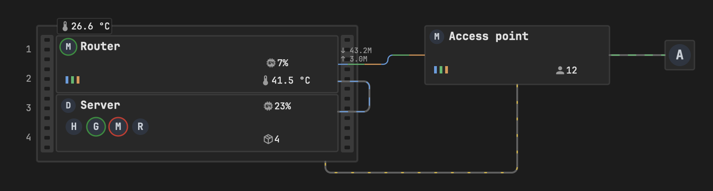

- [The basics](#the-basics)
- [Card options](#card-options)
- [Items](#items): [rack](#rack), [rackdevice](#rackdevice), [device](#device), [endpoint](#endpoint), [device status](#device-status), [textures](#textures), [badge](#badge), [thresholds](#thresholds), [chip](#chip), [led](#led), [label](#label), [group](#group), [ports and port](#ports-and-port), [pool, hdd, ssd, bay](#pool-hdd-ssd-bay), [fanpanel and fan](#fanpanel-and-fan)
- [Lines](#lines): [where a line starts and ends](#where-a-line-starts-and-ends), [points](#points), [line_radius](#line_radius), [open ends](#open-ends)
- [Datalines](#datalines): [vlans](#vlans), [flow](#flow), [status](#status), [rx and tx](#rx-and-tx), [rates](#rates)
- [Powerlines](#powerlines)
- [Switches](#switches)
- [Pan and zoom](#pan-and-zoom)
- [Font](#font)
- [look](#look)
- [background](#background)
- [debug](#debug)
- [Errors](#errors)

Complete, ready-to-copy setups are in [Examples](examples.md).

## The basics

A map has three lists:

- `items`: racks, devices, endpoints, and what is shown on them (badges, chips, LEDs, labels, groups, ports, disks, fans)
- `datalines`: network cables
- `powerlines`: power cables

Everything is measured in **pixels**, `[x, y]` meaning *x px to the right, y px down*.

- `at` is always the **top-left corner** of an item.
- An item inside another item's `items` is placed **relative to its parent's top-left corner**. Negative values are allowed, e.g. to pin a badge on the edge of a rack.
- Every item and every line has an `id`. Ids must be unique across the whole map.

Some screenshots below have `debug: true` turned on, which draws the coordinate grid and outlines every item.

## Card options

```yaml
type: custom:ha-homelab-map
font: JetBrains Mono
look: depth
background: blueprint
line_radius: 6
vlans:
  LAN: "#6c9cda"
  IoT: "#66b771"
scale: 1.5
fit_viewport: false
vlan_toggle: true
power_toggle: true
animation_toggle: true
debug_toggle: true
toggles_at: [860, 20]
debug: false
items: []
datalines: []
powerlines: []
```

| Option | Default | Description |
| --- | --- | --- |
| `items` | **required** | See [Items](#items) |
| `datalines` | | See [Datalines](#datalines) |
| `powerlines` | | See [Powerlines](#powerlines) |
| `vlans` | | Colour for each VLAN name, used by datalines and LEDs |
| `font` | theme font | Font family for all text on the card – see [Font](#font) |
| `look` | `flat` | `depth` adds subtle shadows and relief – see [look](#look) |
| `background` | `none` | A decorative backdrop behind the map – see [background](#background) |
| `line_radius` | `6` | Radius of every line corner, in px |
| `scale` | `1` | Zoom of the whole map: `1.5` = 150 %. The map never gets wider than the card; zoom in with a pinch or ctrl/⌘ + wheel for more |
| `fit_viewport` | `false` | Make the map as tall as the browser window (below the card's top edge); `scale` is then ignored |
| `vlan_toggle`, `power_toggle`, `animation_toggle`, `debug_toggle` | `false` | Show the **VLANs**, **Power**, **Animations** and **Debug** switches – see [Switches](#switches) |
| `toggles_at` | top-right corner | `[x, y]` on the map: top-left corner of the switches panel – see [Switches](#switches) |
| `debug` | `false` | Show the [debug](#debug) overlay. With `debug_toggle`, the starting position of the switch |

The map grows to fit everything you place; you never set its size.

## Items

| `type` | Is placed with | Size | Can contain (`items`) | Can be inside |
| --- | --- | --- | --- | --- |
| [`rack`](#rack) | `at` | from `units` | rackdevice, fanpanel, and everything a device can contain | the map |
| [`rackdevice`](#rackdevice) | `u`, `units` | rack width | badge, chip, led, label, group, ports, pool, disks, fan | a rack |
| [`device`](#device) | `at` | `size` | badge, chip, led, label, group, ports, pool, disks, fan | the map, a rack |
| [`endpoint`](#endpoint) | `at` | 32 × 32 | chip, label | the map |
| [`badge`](#badge), [`chip`](#chip), [`led`](#led), [`label`](#label) | `at` | own | – | the map, a rack, a device, a group (chip and label also an endpoint) |
| [`group`](#group) | `at` | – | badge, chip, led, label, fan | the map, a rack, a device |
| [`ports`](#ports-and-port) | `at` | – | port | the map, a rack, a device |
| [`pool`](#pool-hdd-ssd-bay) | `at` | `size` | hdd, ssd, bay | the map, a rack, a device |
| [`hdd`, `ssd`, `bay`](#pool-hdd-ssd-bay) | `at` | 27 × 36 | – | the map, a rack, a device, a pool |
| [`fanpanel`](#fanpanel-and-fan) | `u`, `units` | rack width | – | a rack |
| [`fan`](#fanpanel-and-fan) | `at` | `size` | – | the map, a rack, a device, a group |

Racks, rackdevices, devices and endpoints are **devices**: lines connect to them (and to [ports](#ports-and-port)), and they have a frame with 2 px rounded corners.

### Positions inside a parent

```yaml
type: custom:ha-homelab-map
debug: true
items:
  - type: device
    id: nas
    at: [50, 30]
    size: [200, 80]
    items:
      - {type: label, id: nas_name, at: [10, 10], text: "at: [10, 10]", size: 10}
      - {type: label, id: corner, at: [140, 60], text: "at: [140, 60]", size: 10}
      - {type: badge, id: nas_temp, at: [-20, -10], entity: sensor.nas_temperature, icon: "mdi:thermometer", show_border: true}
```

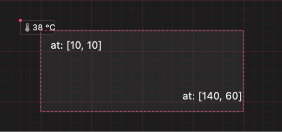

The device `nas` is at `[50, 30]` on the map. Its labels are at `[10, 10]` and `[140, 60]` inside it, and the badge at `[-20, -10]` sticks out over its top-left corner.

### `rack`

A 19" cabinet: 347 px wide and 32 px per U, with a 10 px frame at the top and bottom. Unit numbers are drawn on the left, outside the rack.

```yaml
type: custom:ha-homelab-map
debug: true
items:
  - type: rack
    id: rack
    at: [0, 0]
    units: 6
    items:
      - {type: rackdevice, id: patch, u: 1}
      - {type: rackdevice, id: router, u: 2, units: 2}
      - {type: rackdevice, id: ups, u: 5, units: 2}
      - {type: device, id: poe, at: [150, 108], size: [10, 30]}
      - {type: badge, id: rack_temp, at: [22, -8], entity: sensor.rack_temperature, icon: "mdi:thermometer", decimals: 1, size: 10, show_border: true}
```

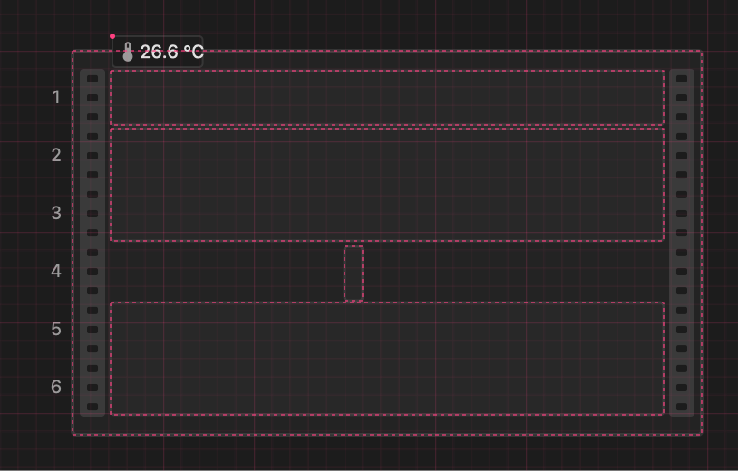

| Option | Description |
| --- | --- |
| `at` | Top-left corner |
| `units` | Height in U |
| `items` | What is inside – rackdevices, a fanpanel, and anything else placed relative to the rack, such as the narrow `poe` device and the temperature badge above |

### `rackdevice`

A device that fills the rack from rail to rail. It goes in a rack's `items`.

```yaml
- {type: rackdevice, id: router, u: 2, units: 2}
```

| Option | Default | Description |
| --- | --- | --- |
| `u` | **required** | First unit, counted from the top (U1 is the top) |
| `units` | `1` | Height in U |
| `status_entity`, `status_map` | | Colour the frame from an entity – see [device status](#device-status) |
| `texture`, `texture_opacity` | | A pattern on the front – see [textures](#textures) |
| `items` | | What is shown on it, relative to the rackdevice |

A rackdevice is 305 px wide (between the rails) and `units × 32 − 2` px tall. The 2 px leave a gap between neighbours.

### `device`

A box with a size you choose, on the map or inside a rack.

```yaml
type: custom:ha-homelab-map
debug: true
items:
  - {type: device, id: router, at: [0, 0], size: [200, 60]}
  - {type: device, id: nas, at: [250, 0], size: [150, 100]}
  - {type: device, id: switch, at: [0, 100], size: [200, 40]}
```

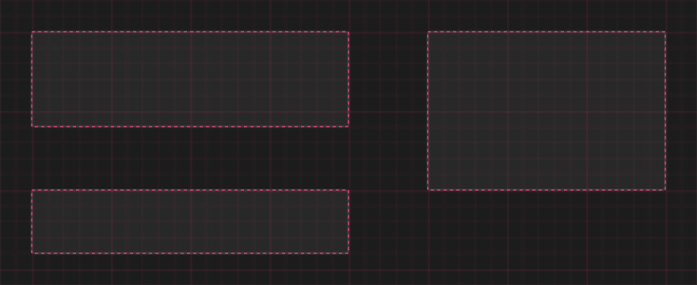

| Option | Description |
| --- | --- |
| `at` | Top-left corner |
| `size` | `[width, height]` |
| `status_entity`, `status_map` | Colour the frame from an entity – see [device status](#device-status) |
| `texture`, `texture_opacity` | A pattern on the front – see [textures](#textures) |
| `items` | What is shown on it, relative to the device |

### `endpoint`

A small 32 × 32 px box (1U × 1U) for something that is only connected, such as a TV, a console or a camera. It shows either an MDI icon or a chip.

```yaml
type: custom:ha-homelab-map
items:
  - {type: endpoint, id: camera, at: [0, 0], icon: "mdi:cctv"}
  - type: endpoint
    id: tv
    at: [60, 0]
    items:
      - {type: chip, id: tv_logo, at: [4, 4], size: 24, image: /local/ha-homelab-map/logos/android.svg, status_entity: binary_sensor.tv_online}
  - type: endpoint
    id: console
    at: [120, 0]
    items:
      - {type: chip, id: console_logo, at: [4, 4], size: 24, image: /local/ha-homelab-map/logos/xbox.svg}
      - {type: label, id: console_caption, at: [0, 36], text: Xbox, size: 8, color: secondary}
```

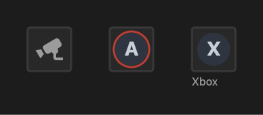

| Option | Description |
| --- | --- |
| `at` | Top-left corner |
| `icon` | Any [Material Design icon](https://pictogrammers.com/library/mdi/), e.g. `mdi:television` |
| `items` | One or more [chips](#chip) (e.g. a logo with a status ring – here the TV is off), and optionally labels |

Use either `icon` or a chip, not both.

### Device status

A `device` or `rackdevice` with `status_entity` gets an **orange** frame for a warning and a **red** frame when it is down. Clicking the device (outside its badges, chips and ports) opens the entity's dialog.

```yaml
type: custom:ha-homelab-map
items:
  - type: device
    id: nas
    at: [0, 0]
    size: [120, 36]
    status_entity: binary_sensor.nas_online
    items:
      - {type: label, id: nas_name, at: [8, 6], text: NAS, size: 11, bold: true}
      - {type: label, id: nas_state, at: [8, 21], text: online – ok, size: 8, color: secondary}
  - type: device
    id: ups
    at: [140, 0]
    size: [120, 36]
    status_entity: sensor.ups_status
    status_map: {LB: down, OB: warn, OL: ok}
    items:
      - {type: label, id: ups_name, at: [8, 6], text: UPS, size: 11, bold: true}
      - {type: label, id: ups_state, at: [8, 21], text: OB DISCHRG – warn, size: 8, color: secondary}
  - type: device
    id: printer
    at: [280, 0]
    size: [120, 36]
    status_entity: binary_sensor.printer_online
    items:
      - {type: label, id: printer_name, at: [8, 6], text: Printer, size: 11, bold: true}
      - {type: label, id: printer_state, at: [8, 21], text: off – down, size: 8, color: secondary}
```

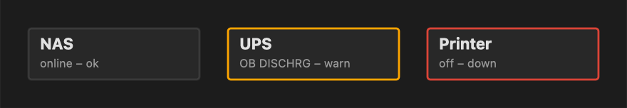

| Option | Description |
| --- | --- |
| `status_entity` | Any entity. Without `status_map`, the device is down when the entity is `unavailable`, `unknown`, `off`, `down`, `offline`, `disconnected`, `not_home` or missing, and OK otherwise – so a CPU-load sensor means "reachable" |
| `status_map` | State → `ok`, `warn` or `down`, e.g. `{LB: down, OB: warn, OL: ok}` for a UPS. Each word of the state is checked (`OB DISCHRG` matches `OB`), the first listed key wins, and a state that is not listed is `warn` |

### Textures

A `device`, `rackdevice` or `fanpanel` can have a pattern on its whole front, drawn under its content. Textures are faint and dark, so text on top stays readable.

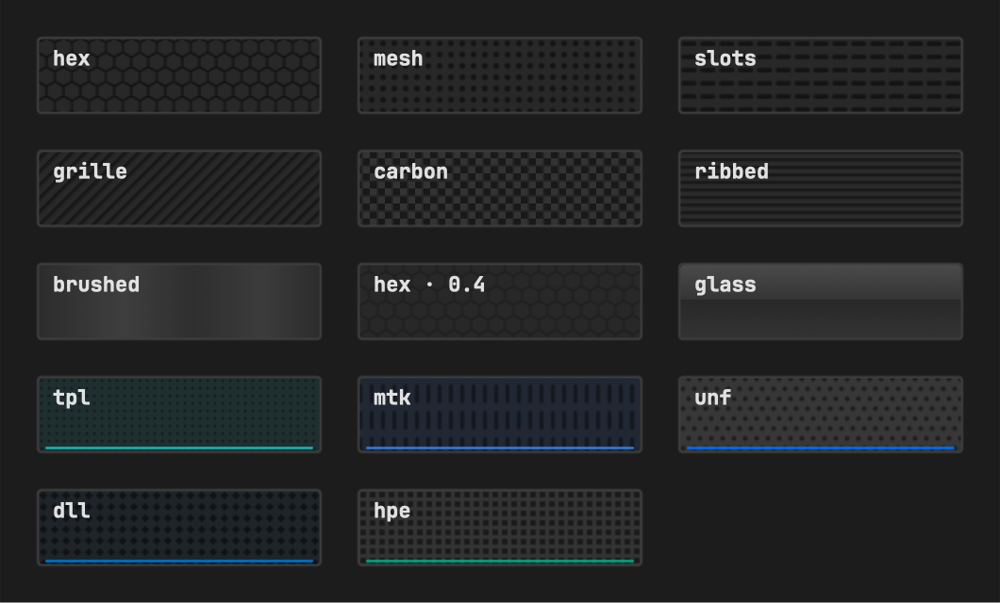

```yaml
- {type: rackdevice, id: server, u: 5, units: 4, texture: hex}
- {type: device, id: switch, at: [600, 300], size: [240, 50], texture: brushed, texture_opacity: 0.6}
```

| Option | Default | Description |
| --- | --- | --- |
| `texture` | | `hex`, `mesh`, `slots`, `grille`, `carbon`, `ribbed`, `brushed`, `glass` – or one inspired by a vendor's hardware: `tpl` (TP-Link Omada), `mtk` (MikroTik), `unf` (UniFi), `dll` (Dell), `hpe` (HPE) |
| `texture_opacity` | `1` | Strength of the texture, from `0` to `1` |

The vendor-inspired textures add a tint and a thin line in the vendor's colour along the bottom edge. They only borrow a style – no logos or trademarks are drawn.

### `badge`

A live value of an entity, with an optional icon in front.

```yaml
type: custom:ha-homelab-map
font: JetBrains Mono
items:
  - type: device
    id: server
    at: [0, 0]
    size: [380, 70]
    items:
      - {type: badge, id: cpu, at: [10, 10], entity: sensor.cpu, icon: "mdi:cpu-64-bit"}
      - {type: badge, id: temp, at: [80, 10], entity: sensor.temp, icon: "mdi:thermometer", decimals: 1}
      - {type: badge, id: clients, at: [170, 10], entity: sensor.clients, icon: "mdi:account", units: none}
      - {type: badge, id: speed, at: [240, 10], entity: sensor.speed, icon: "mdi:download", units: Mb/s}
      - {type: badge, id: big, at: [10, 36], entity: sensor.temp, icon: "mdi:thermometer", size: 12, show_border: true}
      - {type: badge, id: plain, at: [130, 40], entity: sensor.cpu, icon: none, size: 10}
      - {type: badge, id: missing, at: [200, 40], entity: sensor.gone, icon: "mdi:gauge", size: 10}
```

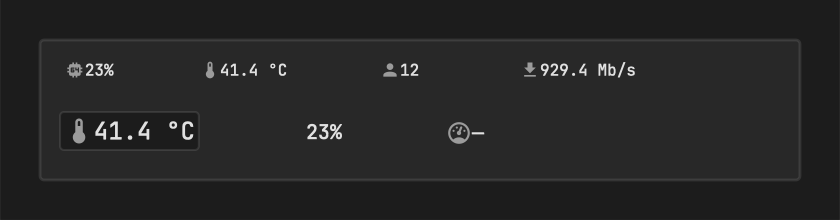

| Option | Default | Description |
| --- | --- | --- |
| `entity` | **required** | The entity to show |
| `icon` | **required** | An MDI icon such as `mdi:thermometer`, or `none` for no icon |
| `units` | `true` | `true`: the entity's own unit. Your own text (`units: Mb/s`) replaces it. `none` hides it |
| `decimals` | as Home Assistant shows it | Number of decimal places |
| `size` | `8` | Font size in px |
| `show_border` | `false` | Draw a frame around the badge (2 px padding) |
| `toggle` | | A [group](#group) id – clicking the badge shows or hides that group |
| `thresholds` | | Colour the icon and value when a limit is reached – see [thresholds](#thresholds) |

- Clicking a badge opens the entity's dialog (unless it has `toggle`).
- When the entity is unavailable or missing, the badge shows `—`.
- **Fixed width.** For these units a badge reserves room for its widest value, so neighbours never collide when the value grows; the icon and value are centred in that room:

  | Unit | Room reserved for |
  | --- | --- |
  | `%` | `100%` |
  | `°C` | `99.9 °C` (with the badge's decimals) |
  | `V` | `999.9 V` |
  | `Mbps` | `999 Mbps` |
  | `ms` | `999 ms` |
  | `W` | `9999 W` |
  | no unit | `99` |

  With other units the value starts right after the icon and grows to the right.

### Thresholds

The one way the card flags a problem value: when a threshold is reached, the badge's icon and value take its colour. Pools ([fill](#pool-hdd-ssd-bay)), disks (temperature) and [fans](#fanpanel-and-fan) (rotor) use the same `thresholds`.

```yaml
type: custom:ha-homelab-map
font: JetBrains Mono
items:
  - type: device
    id: server
    at: [0, 0]
    size: [300, 30]
    items:
      - {type: badge, id: cpu, at: [6, 6.5], entity: sensor.cpu, icon: "mdi:cpu-64-bit", size: 10, show_border: true, thresholds: [{above: 80, color: orange}, {above: 90, color: red}]}
      - {type: badge, id: ram, at: [52, 6.5], entity: sensor.ram, icon: "mdi:memory", size: 10, show_border: true, thresholds: [{above: 80, color: orange}, {above: 90, color: red}]}
      - {type: badge, id: disk, at: [98, 6.5], entity: sensor.disk, icon: "mdi:harddisk", size: 10, show_border: true, thresholds: [{above: 85, color: orange}, {above: 95, color: red}]}
      - {type: badge, id: battery, at: [144, 6.5], entity: sensor.battery, icon: "mdi:battery", size: 10, show_border: true, thresholds: [{below: 50, color: orange}, {below: 20, color: red}]}
      - {type: badge, id: temp, at: [190, 6.5], entity: sensor.temp, icon: "mdi:thermometer", decimals: 1, size: 10, show_border: true, thresholds: [{above: 70, color: orange}, {above: 85, color: red}]}
```

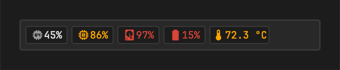

```yaml
thresholds: [{above: 80, color: orange}, {above: 90, color: red}]   # CPU, RAM
thresholds: [{below: 50, color: orange}, {below: 20, color: red}]   # battery
```

- Each entry has `above` or `below`, and a `color`: `red`, `orange`, `green` (your theme's error, warning and success colours), `yellow`, or any colour such as `"#e91e63"`.
- *Reached* means equal or beyond: `above: 90` is reached at 90.
- When several are reached, the **last** one in the list wins – list them from mild to severe. `above` and `below` can be mixed.
- The entity's raw number is compared, in its own unit. Non-numeric and unavailable states are never coloured.
- Don't put thresholds on values that are normally at their limit – an NVR disk is always about 100 % full.

### `chip`

A round logo, as for containers or device brands, with blinking status and update rings.

```yaml
type: custom:ha-homelab-map
items:
  - type: device
    id: server
    at: [0, 0]
    size: [250, 40]
    items:
      - {type: chip, id: running, at: [10, 11], size: 18, image: /local/ha-homelab-map/logos/home-assistant.svg, status_entity: sensor.ha_state}
      - {type: chip, id: stopped, at: [40, 11], size: 18, image: /local/ha-homelab-map/logos/mosquitto.svg, status_entity: sensor.mqtt_state}
      - {type: chip, id: update, at: [70, 11], size: 18, image: /local/ha-homelab-map/logos/grafana.svg, status_entity: sensor.grafana_state, update_entity: binary_sensor.grafana_update}
      - {type: chip, id: both, at: [100, 11], size: 18, image: /local/ha-homelab-map/logos/postgres.svg, status_entity: sensor.pg_state, update_entity: binary_sensor.pg_update}
      - {type: chip, id: link, at: [130, 11], size: 18, image: /local/ha-homelab-map/logos/nginx.svg, url: "https://example.com"}
      - {type: chip, id: icon, at: [160, 11], size: 18, icon: "mdi:docker"}
      - {type: chip, id: helper, at: [190, 11], size: 18, image: /local/ha-homelab-map/logos/redis.svg, small_image: /local/ha-homelab-map/logos/immich.svg, status_entity: sensor.immich_redis_state}
      - {type: chip, id: os, at: [220, 11], size: 18, image: /local/ha-homelab-map/logos/debian.svg, small_entity: sensor.os_updates, update_entity: sensor.os_updates}
```

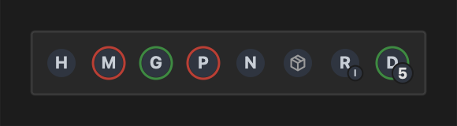

From left: running; stopped (red ring); running with an update (green ring); stopped *and* with an update (the ring alternates red and green); a link without rings; an MDI icon; a database with the small logo of the app it belongs to; an OS logo with the number of pending updates.

| Option | Default | Description |
| --- | --- | --- |
| `icon` / `image` | one of the two | An MDI icon, or the path to an image |
| `size` | `16` | Diameter in px |
| `status_entity` | | A blinking **red** ring when this entity is not up. Up means `on`, `true`, `1`, `running`, `home` or `ok`; anything else, unavailable or missing is down |
| `update_entity` | | A blinking **green** ring when this entity is `on`, `true`, `1` or a number above 0 – e.g. an `update.*` entity or a pending-updates count |
| `small_image` | | A small logo at the lower right, e.g. the app a database container belongs to |
| `small_entity` | | A small number at the lower right, e.g. pending OS updates. Hidden at 0, `99+` above 99. Not together with `small_image` |
| `url` | | Opened in a new tab on click |

The screenshots in this documentation show a letter where your logo image would be – no logos are shipped with the card. Images under `config/www/` are available as `/local/…`; e.g. `config/www/ha-homelab-map/logos/grafana.svg` is `/local/ha-homelab-map/logos/grafana.svg`. With the **Animations** switch off, the rings stay lit (red wins over green).

### `led`

A small light, e.g. one per VLAN on a switch, that flickers like a port light.

```yaml
type: custom:ha-homelab-map
vlans: {LAN: "#6c9cda", IoT: "#66b771", NoT: "#d6995c", CAM: "#aa92d3"}
items:
  - type: device
    id: router
    at: [0, 0]
    size: [200, 40]
    items:
      - {type: led, id: lan, at: [10, 16], vlan: LAN}
      - {type: led, id: iot, at: [16, 16], vlan: IoT, effect: blink}
      - {type: led, id: not, at: [22, 16], vlan: NoT, effect: none}
      - {type: led, id: cam, at: [28, 16], vlan: CAM, entity: binary_sensor.cam_vlan}
      - {type: led, id: bar, at: [50, 24], size: [18, 3], vlan: LAN, caption: LAN}
      - {type: led, id: bar2, at: [72, 24], size: [18, 3], vlan: IoT, caption: IoT}
      - {type: led, id: power, at: [180, 16], size: [8, 8], color: "#43a047", effect: none}
```

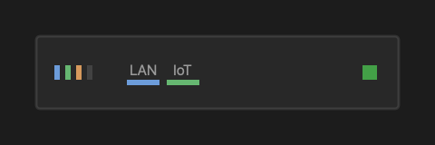

From left: LAN flickering, IoT blinking, NoT steady, CAM dark (its entity is off), two wide bars with captions, a square green LED.

| Option | Default | Description |
| --- | --- | --- |
| `vlan` / `color` | one of the two | A VLAN from the card's `vlans`, or any colour such as `"#43a047"` |
| `size` | `[3, 8]` | `[width, height]` in px |
| `effect` | `flicker` | `flicker` (random, like a busy port), `blink` (on/off once a second) or `none` (steady) |
| `entity` | | When set, the LED is lit only while the entity is up (as for chips) and dark grey otherwise |
| `caption` | | Text centred above the LED (8 px, secondary colour) – e.g. a VLAN legend. Only together with an explicit `size` |

VLAN LEDs stop flickering and stay lit while the **VLANs** or **Animations** switch is off.

### `label`

Fixed text: device names, legends, notes.

```yaml
type: custom:ha-homelab-map
vlans: {LAN: "#6c9cda", IoT: "#66b771"}
items:
  - type: device
    id: router
    at: [0, 0]
    size: [200, 60]
    items:
      - {type: label, id: router_name, at: [8, 6], text: Router, size: 12, bold: true}
      - {type: label, id: legend_lan, at: [10, 38], text: LAN, size: 8, color: secondary}
      - {type: label, id: legend_iot, at: [34, 38], text: IoT, size: 8, color: secondary}
      - {type: led, id: lan, at: [10, 48], size: [18, 3], vlan: LAN}
      - {type: led, id: iot, at: [32, 48], size: [18, 3], vlan: IoT}
      - {type: label, id: warn, at: [130, 6], text: maintenance, color: "#d26066"}
  - type: device
    id: poe
    at: [220, 0]
    size: [10, 60]
    items:
      - {type: label, id: poe_text, at: [1, 6], text: PoE injector, size: 7, vertical: true}
```

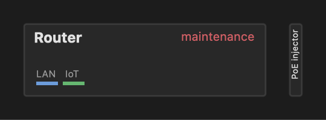

| Option | Default | Description |
| --- | --- | --- |
| `text` | **required** | The text |
| `size` | `10` | Font size in px |
| `bold` | `false` | Bold text |
| `color` | `primary` | `primary` (main text colour), `secondary` (dimmer grey) or any colour such as `"#d26066"` |
| `vertical` | `false` | Rotated to read bottom to top. `at` is still the top-left corner of the rotated text |

### `group`

An invisible container. Everything in it moves with its `at`, and a badge with `toggle` can show or hide it.

```yaml
type: custom:ha-homelab-map
items:
  - type: device
    id: server
    at: [0, 0]
    size: [200, 70]
    items:
      - type: group
        id: containers
        at: [8, 22]
        items:
          - {type: chip, id: c1, at: [0, 0], size: 18, image: /local/ha-homelab-map/logos/home-assistant.svg, status_entity: sensor.ha_state}
          - {type: chip, id: c2, at: [24, 0], size: 18, image: /local/ha-homelab-map/logos/grafana.svg, update_entity: binary_sensor.grafana_update}
          - {type: chip, id: c3, at: [48, 0], size: 18, image: /local/ha-homelab-map/logos/redis.svg}
      - {type: badge, id: count, at: [150, 52], entity: sensor.running, icon: "mdi:docker", size: 10, toggle: containers}
```

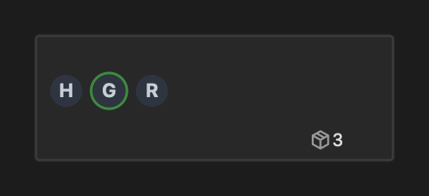

```yaml
- {type: badge, id: count, at: [150, 52], entity: sensor.running, icon: "mdi:docker", size: 10, toggle: containers}
```

Clicking the count hides the group; the count turns bold while the group is hidden:

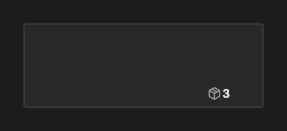

| Option | Description |
| --- | --- |
| `at` | Top-left corner; the items inside are relative to it |
| `items` | Badges, chips, LEDs, labels and fans |

Groups start visible. Each browser remembers which groups it has hidden.

### `ports` and `port`

Network ports (or camera inputs) whose colour shows the link state. A `ports` container holds `port` items placed by hand, and a line can end on a port instead of a device.

```yaml
type: custom:ha-homelab-map
items:
  - type: device
    id: switch
    at: [0, 0]
    size: [150, 44]
    items:
      - {type: label, id: switch_name, at: [8, 6], text: Switch, size: 11, bold: true}
      - type: ports
        id: switch_ports
        at: [8, 24]
        size: 12
        items:
          - {type: port, id: p1, at: [0, 0], entity: sensor.switch_p1_rate}
          - {type: port, id: p2, at: [16, 0], entity: sensor.switch_p2_rate}
          - {type: port, id: p3, at: [32, 0], entity: sensor.switch_p3_rate}
          - {type: port, id: p4, at: [48, 0], entity: sensor.switch_p4_rate}
          - {type: port, id: p5, at: [64, 0], entity: binary_sensor.switch_p5_connection}
  - type: device
    id: nvr
    at: [190, 0]
    size: [110, 44]
    items:
      - {type: label, id: nvr_name, at: [8, 6], text: NVR, size: 11, bold: true}
      - type: ports
        id: cameras
        at: [8, 24]
        size: 12
        icon: "mdi:cctv"
        states: {recording: active, online: warn, offline: fault, empty: inactive}
        items:
          - {type: port, id: cam1, at: [0, 0], entity: sensor.nvr_camera_1}
          - {type: port, id: cam2, at: [16, 0], entity: sensor.nvr_camera_2}
          - {type: port, id: cam3, at: [32, 0], entity: sensor.nvr_camera_3}
          - {type: port, id: cam4, at: [48, 0], entity: sensor.nvr_camera_4}
  - type: device
    id: printer
    at: [30, 100]
    size: [80, 26]
    items:
      - {type: label, id: printer_name, at: [8, 7], text: Printer, size: 10}
datalines:
  - {id: p4-printer, start_port: p4, start_edge: bottom, end_device: printer, end_edge: top, end_point: 40}
```

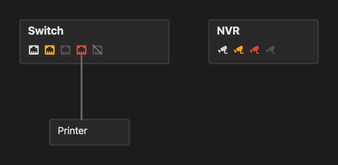

Switch, from left: active at the expected speed; slower than expected (100 Mbps); no cable; no link although a cable ends here (fault); disabled. NVR: recording, online, offline, empty.

| `ports` option | Default | Description |
| --- | --- | --- |
| `at` | | Top-left corner |
| `size` | `12` | Icon size in px |
| `speed` | `1Gbps` | Expected link speed – slower links are orange |
| `icon` | `mdi:ethernet` | Icon of all ports, e.g. `mdi:cctv` for camera inputs |
| `states` | | State → `active`, `warn`, `inactive`, `fault` or `disabled`, checked first and case-insensitive – e.g. NVR channels `{recording: active, online: warn, offline: fault, empty: inactive}` |
| `items` | | `port` items |

| `port` option | Description |
| --- | --- |
| `at` | Relative to its `ports` |
| `entity` | The link entity (see below) |
| `speed` | Overrides the container's expected speed for this port |

| Colour | Means |
| --- | --- |
| white | active – link at the expected speed or faster |
| orange | warn – slower, or half duplex while the other end could do full duplex |
| dimmed | no link, and no cable on the map ends at this port |
| **red** | fault – no link although a map line ends at this port (a cable is expected), or an SFP fault |
| crossed out | the port is disabled |

Port entities, best first:

1. The MikroTik Router integration's `binary_sensor.<device>_<interface>_connection`: its `enabled`, `status`, `rate`, `full_duplex` and SFP attributes give all five states.
2. A speed text (`1Gbps`, `2.5Gbps`, `100Mbps`, `10 Gbit/s`), or a bare number read in the entity's unit (Mbps without one).
3. An on/off entity.

Clicking a port opens its entity.

### `pool`, `hdd`, `ssd`, `bay`

Storage: disks and the pools (ZFS, RAID…) they belong to.

```yaml
type: custom:ha-homelab-map
items:
  - type: device
    id: nas
    at: [0, 0]
    size: [190, 82]
    items:
      - {type: label, id: nas_name, at: [8, 6], text: NAS, size: 11, bold: true}
      - type: pool
        id: tank
        at: [8, 22]
        size: [66, 48]
        label: TANK
        usage_entity: sensor.tank_used
        status_entity: sensor.tank_state
        status_map: {ONLINE: ok, DEGRADED: warn, FAULTED: down}
        thresholds: [{above: 85, color: orange}, {above: 95, color: red}]
        items:
          - {type: hdd, id: tank_1, at: [4, 4], temperature: sensor.sda_temperature, status_entity: binary_sensor.sda_health, thresholds: [{above: 50, color: orange}, {above: 60, color: red}]}
          - {type: hdd, id: tank_2, at: [35, 4], temperature: sensor.sdb_temperature, status_entity: binary_sensor.sdb_health, thresholds: [{above: 50, color: orange}, {above: 60, color: red}]}
      - {type: ssd, id: system, at: [84, 26], temperature: sensor.nvme_temperature, status_entity: binary_sensor.nvme_health}
      - {type: bay, id: bay_4, at: [119, 26]}
```

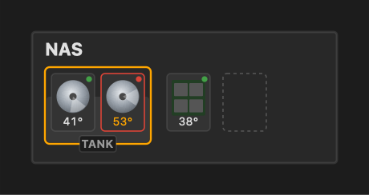

A `pool` is a container placed by hand around its disks:

| `pool` option | Description |
| --- | --- |
| `at`, `size` | Top-left corner and `[width, height]` |
| `label` | Text on a tag centred on the bottom edge (it sticks out 5 px below) |
| `usage_entity` | % used – shown as a fill rising from the bottom. Click opens it |
| `thresholds` | Colour of the fill – see [thresholds](#thresholds) |
| `status_entity`, `status_map` | Outline colour, as for [devices](#device-status), e.g. `{ONLINE: ok, DEGRADED: warn, FAULTED: down}` |
| `items` | `hdd`, `ssd` and `bay` |

Disks are 27 × 36 px trays:

| `hdd` / `ssd` option | Description |
| --- | --- |
| `at`, `size` | Top-left corner and `[width, height]` (default `[27, 36]`) |
| `temperature` | Shown at the bottom (`41°`); click opens it |
| `thresholds` | Colour of the temperature |
| `status_entity`, `status_map` | The LED in the top-right corner: green OK, orange warn, red down. A down HDD stops spinning and gets a red outline |

An `hdd` has a spinning platter (it stops with the **Animations** switch); an `ssd` shows a chip board. A `bay` (`at`, `size`) is an empty slot with a dashed outline.

### `fanpanel` and `fan`

A rack panel with fans, and single fans you can place anywhere.

```yaml
type: custom:ha-homelab-map
items:
  - type: rack
    id: rack
    at: [20, 0]
    units: 3
    items:
      - {type: fanpanel, id: rack_fans, u: 1, units: 2, count: 4, entity: sensor.rack_temperature, range: [27, 35]}
      - type: rackdevice
        id: server
        u: 3
        items:
          - {type: label, id: server_name, at: [8, 8], text: Server, size: 11, bold: true}
  - {type: fan, id: case_fan, at: [400, 20], size: 40, entity: sensor.case_fan_rpm, range: [0, 3000], thresholds: [{below: 500, color: red}]}
  - {type: fan, id: cpu_fan, at: [460, 20], size: 40, entity: sensor.cpu_fan_rpm, range: [0, 3000], thresholds: [{below: 500, color: red}]}
```

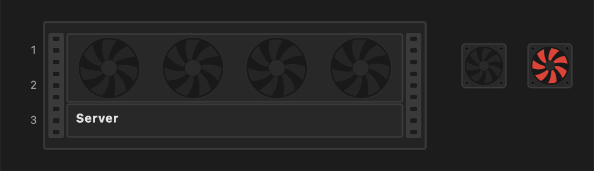

```yaml
- {type: fanpanel, id: rack_fans, u: 1, units: 2, count: 4, entity: sensor.rack_temperature, range: [27, 35]}
- {type: fan, id: case_fan, at: [400, 20], size: 40, entity: sensor.case_fan_rpm, range: [0, 3000], thresholds: [{below: 500, color: red}]}
```

| Option | Default | Description |
| --- | --- | --- |
| `u`, `units` (`fanpanel`) | units `2` | Position in the rack, like a rackdevice. The panel sits behind devices and cables |
| `count` (`fanpanel`) | `4` | Fans, spread evenly |
| `at`, `size` (`fan`) | size `24` | A square chassis with four screw holes |
| `entity` | | Drives the speed |
| `range` | `[0, 100]` | `[slow, fast]`: at or below `slow` the fan turns slowly, at or above `fast` quickly – a temperature (`[27, 35]`), a % or RPM (`[0, 3000]`) |
| `thresholds` | | Colour of the rotor – you decide whether a stopped or slow fan is a fault |
| `texture`, `texture_opacity` (`fanpanel`) | | A pattern on the panel – see [textures](#textures) |

`on` = full speed; `0`, `off`, an unavailable or unknown state or a missing entity = stopped; no `entity` at all = slow. The rotors stop with the **Animations** switch.

## Lines

Datalines and powerlines share these options:

| Option | Default | Description |
| --- | --- | --- |
| `id` | **required** | Unique, like item ids |
| `start_device` / `start_port`, `end_device` / `end_port` | **required** | Each end: the id of a device (rack, rackdevice, device or endpoint) **or** of a port. A dataline may leave one end open – see [open ends](#open-ends) |
| `start_edge`, `end_edge` | **required** | `top`, `right`, `bottom` or `left` – of the device, or of the port icon |
| `start_point`, `end_point` | `50` | Where on that edge, in % – see below |
| `points` | | `[x, y]` map points the line passes through, in order |
| `flow` | static | Animation direction. Without `flow` the line does not move |

Lines are drawn over devices.

### Where a line starts and ends

- `top` and `bottom` edges: `0` is the left corner, `100` the right corner.
- `left` and `right` edges: `0` is the top corner, `100` the bottom corner.

```yaml
type: custom:ha-homelab-map
debug: true
items:
  - {type: device, id: switch, at: [100, 70], size: [200, 60]}
  - {type: endpoint, id: a, at: [84, 0], icon: "mdi:cctv"}
  - {type: endpoint, id: b, at: [184, 0], icon: "mdi:cctv"}
  - {type: endpoint, id: c, at: [284, 0], icon: "mdi:cctv"}
  - {type: endpoint, id: d, at: [0, 84], icon: "mdi:cctv"}
  - {type: endpoint, id: e, at: [368, 84], icon: "mdi:cctv"}
datalines:
  - {id: top-0, start_device: switch, start_edge: top, start_point: 0, end_device: a, end_edge: bottom}
  - {id: top-50, start_device: switch, start_edge: top, end_device: b, end_edge: bottom}
  - {id: top-100, start_device: switch, start_edge: top, start_point: 100, end_device: c, end_edge: bottom}
  - {id: left, start_device: switch, start_edge: left, end_device: d, end_edge: right}
  - {id: right, start_device: switch, start_edge: right, end_device: e, end_edge: left}
```

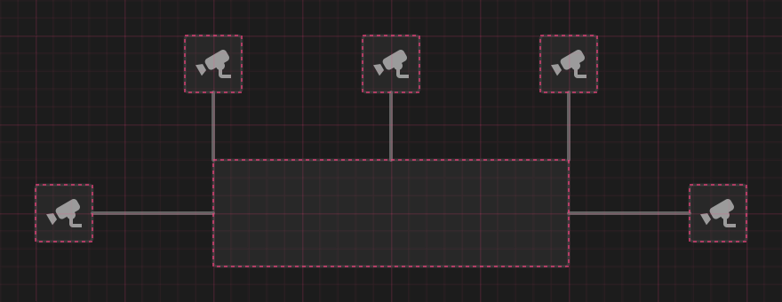

### `points`

Without `points`, a line goes straight from start to end. With them, it goes through each point in order. Segments can go in any direction, diagonals included.

```yaml
type: custom:ha-homelab-map
debug: true
items:
  - {type: device, id: router, at: [0, 0], size: [100, 160]}
  - {type: device, id: ap1, at: [250, 0], size: [100, 40]}
  - {type: device, id: ap2, at: [250, 60], size: [100, 40]}
  - {type: device, id: ap3, at: [250, 120], size: [100, 40]}
datalines:
  - {id: straight, start_device: router, start_edge: right, start_point: 12.5, end_device: ap1, end_edge: left}
  - id: corners
    start_device: router
    start_edge: right
    end_device: ap2
    end_edge: left
    points: [[140, 80], [140, 115], [215, 115], [215, 80]]
  - id: diagonal
    start_device: router
    start_edge: right
    start_point: 87.5
    end_device: ap3
    end_edge: left
    points: [[130, 140], [190, 160], [220, 140]]
```

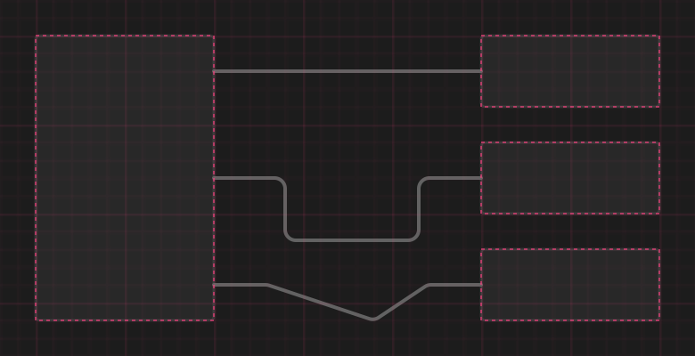

### `line_radius`

Every corner at one of the `points` is rounded with the card's `line_radius`. Where a line touches a device, there is no rounding. The radius shrinks on segments too short for it.

`line_radius: 0`

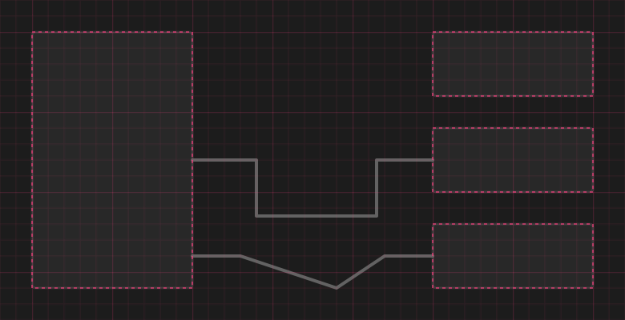

`line_radius: 6` (default)

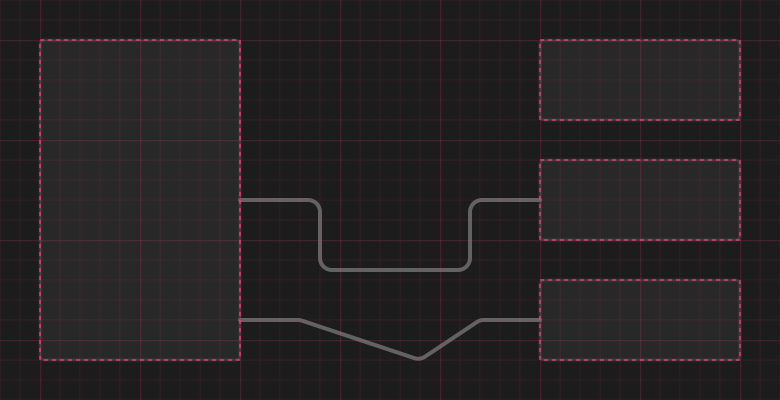

`line_radius: 16`

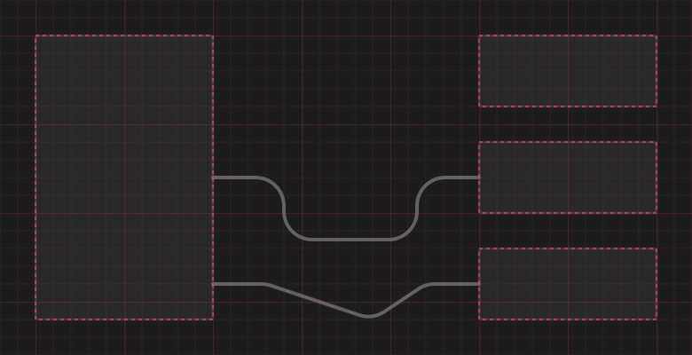

### Open ends

A dataline may leave **one** end unconnected: leave out that end's `*_device` / `*_port`. The last (or first) entry of `points` is then the open end, and the line – static line and animation alike – fades out along that last segment. Use it for the cable that leaves your ONT for "the internet".

```yaml
type: custom:ha-homelab-map
vlans: {WAN: "#2d4abe"}
items:
  - {type: label, id: note, at: [60, 0], text: the cable fades out at the edge of the map, size: 8, color: secondary}
  - type: device
    id: ont
    at: [0, 80]
    size: [160, 30]
    items:
      - {type: label, id: ont_name, at: [8, 9], text: Fibre ONT, size: 11, bold: true}
datalines:
  - id: internet
    start_device: ont
    start_edge: top
    start_point: 20
    points: [[32, -200]]
    vlans: [WAN]
    flow: forward
```

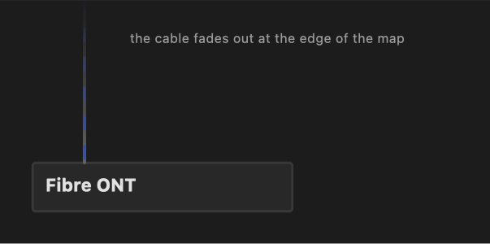

- An open end needs at least one point; `*_edge` and `*_point` are not allowed on it. Powerlines can't have open ends.
- The open end doesn't enlarge the map. If it lies outside the drawing area, the line is cut at the edge and fades out exactly there – a far-away point such as `[32, -200]` makes the cable run to the top of the map.

## Datalines

Network cables. On top of the [common options](#lines):

| Option | Default | Description |
| --- | --- | --- |
| `vlans` | | VLAN names – the colours of the moving dashes |
| `flow` | static | `forward`, `reverse` or `dominant` |
| `status` | `active` | `active`, `inactive` or a `binary_sensor` |
| `rx`, `tx` | | Data-rate sensors |
| `rates_at`, `rates_placement`, `rates_size` | | Show the current rates next to the line – see [rates](#rates) |

### `vlans`

Without `vlans`, a line animates as dots in your theme colour. With one VLAN, as dashes in that colour. With several (a trunk), the dashes cycle through all their colours.

```yaml
type: custom:ha-homelab-map
vlans: {LAN: "#6c9cda", IoT: "#66b771", NoT: "#d6995c"}
items:
  - {type: device, id: router, at: [0, 0], size: [100, 160]}
  - {type: device, id: nas, at: [250, 0], size: [100, 40]}
  - {type: device, id: printer, at: [250, 60], size: [100, 40]}
  - {type: device, id: ap, at: [250, 120], size: [100, 40]}
datalines:
  - {id: no-vlans, start_device: router, start_edge: right, start_point: 12.5, end_device: nas, end_edge: left, flow: forward}
  - {id: one-vlan, start_device: router, start_edge: right, end_device: printer, end_edge: left, flow: forward, vlans: [IoT]}
  - {id: trunk, start_device: router, start_edge: right, start_point: 87.5, end_device: ap, end_edge: left, flow: forward, vlans: [LAN, IoT, NoT]}
```

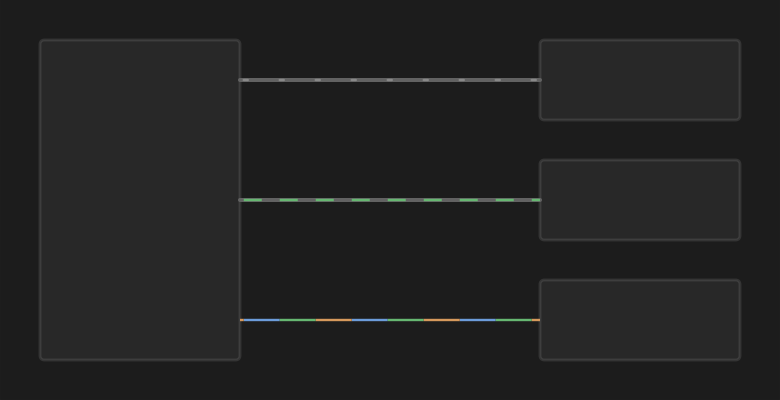

### `flow`

| `flow` | The animation moves… |
| --- | --- |
| *(not set)* | – the line is static |
| `forward` | from the start to the end |
| `reverse` | from the end to the start |
| `dominant` | towards the start when `rx` is larger than `tx`, otherwise towards the end. Needs `rx` and `tx` |

### `status`

| `status` | The line is… |
| --- | --- |
| `active` (default) | drawn and animated normally |
| `inactive` | red and dashed, without animation – e.g. a planned or unplugged cable |
| `binary_sensor.…` | normal while the sensor is `on`; red and dashed when it is `off`, unavailable or missing |

```yaml
type: custom:ha-homelab-map
vlans: {LAN: "#6c9cda"}
items:
  - {type: device, id: router, at: [0, 0], size: [100, 160]}
  - {type: device, id: nas, at: [250, 0], size: [100, 40]}
  - {type: device, id: printer, at: [250, 60], size: [100, 40]}
  - {type: device, id: ap, at: [250, 120], size: [100, 40]}
datalines:
  - {id: sensor-on, start_device: router, start_edge: right, start_point: 12.5, end_device: nas, end_edge: left, vlans: [LAN], flow: forward, status: binary_sensor.nas_link}
  - {id: sensor-off, start_device: router, start_edge: right, end_device: printer, end_edge: left, vlans: [LAN], flow: forward, status: binary_sensor.printer_link}
  - {id: planned, start_device: router, start_edge: right, start_point: 87.5, end_device: ap, end_edge: left, vlans: [LAN], flow: forward, status: inactive}
```

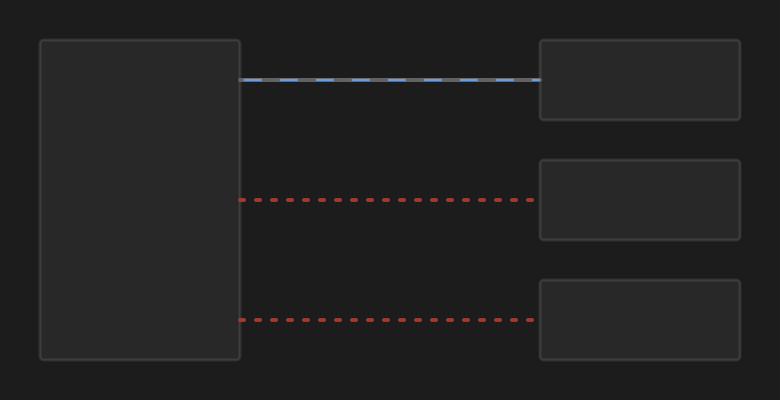

### `rx` and `tx`

Sensors with the current data rate. `rx` is what the **start** device receives, `tx` what it sends.

- More traffic makes the animation faster. With no traffic, it stops.
- With `flow: dominant`, the direction follows the bigger of the two.

Interface counters are often measured on the other device: a router port reports what the *router* sends and receives. The access point at the other end receives what the router sends, so swap them:

```yaml
start_device: ap
rx: sensor.router_ether2_tx
tx: sensor.router_ether2_rx
```

The unit is read from each sensor and converted: `bit/s`, `kbit/s`, `Mbit/s`, `Gbit/s`, `B/s`, `kB/s`, `MB/s`, `GB/s`, `KiB/s`, `MiB/s`, `GiB/s`, the short forms `bps`, `kbps`, `Mbps`, `Gbps` and `kb/s`, `Mb/s`, `Gb/s` for bits; bit units and `KiB/s`–`GiB/s` are also recognised in lower case (`mbit/s`, `mbps`). A sensor without a unit is read as kB/s; a sensor with any other unit shows `—`.

### Rates

`rates_at` shows `↓ rx` and `↑ tx` next to the line, in bits per second (`k`, `M`, `G`). Clicking a value opens its sensor.

```yaml
type: custom:ha-homelab-map
vlans: {LAN: "#6c9cda"}
items:
  - {type: device, id: a, at: [0, 0], size: [80, 40]}
  - {type: device, id: b, at: [300, 0], size: [80, 40]}
  - {type: device, id: c, at: [0, 80], size: [80, 40]}
  - {type: device, id: d, at: [300, 80], size: [80, 40]}
  - {type: device, id: e, at: [0, 160], size: [80, 40]}
  - {type: device, id: f, at: [300, 160], size: [80, 40]}
  - {type: endpoint, id: g, at: [440, 140], icon: "mdi:cctv"}
datalines:
  - {id: start, start_device: a, start_edge: right, end_device: b, end_edge: left, vlans: [LAN], flow: dominant, rx: sensor.rx, tx: sensor.tx, rates_at: start}
  - {id: end-above, start_device: c, start_edge: right, end_device: d, end_edge: left, vlans: [LAN], flow: forward, rx: sensor.rx, tx: sensor.tx, rates_at: end, rates_placement: above}
  - {id: middle-below, start_device: e, start_edge: right, end_device: f, end_edge: left, vlans: [LAN], flow: forward, rx: sensor.rx, tx: sensor.tx, rates_at: 50, rates_placement: below}
  - {id: vertical, start_device: g, start_edge: top, end_device: b, end_edge: right, points: [[456, 20]], vlans: [LAN], flow: forward, rx: sensor.rx, tx: sensor.tx, rates_at: start, rates_size: 7}
```

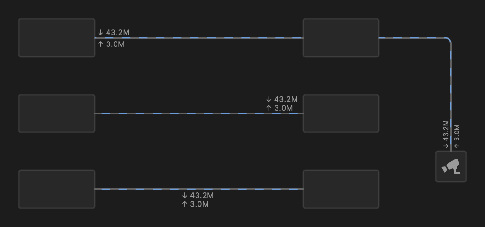

| Option | Default | Description |
| --- | --- | --- |
| `rates_at` | | Turns the rates on. `start`: begins at the start point. `end`: ends at the end point. A number `0`–`100`: centred at that percentage of the line's length (corners included) |
| `rates_placement` | `middle` | `middle`: rx above the line, tx below. `above` or `below`: both values on that side |
| `rates_size` | `8` | Font size in px |

- On a vertical stretch, the text is rotated; there "above" is the left side.
- The two rows always start at the same left edge, so the arrows line up.
- `rates_at` needs `rx` and/or `tx`; a line with only one shows only that value.

## Powerlines

Power cables, with the [common options](#lines). `flow` is `forward` or `reverse`; the animation is gold dots at a steady speed.

```yaml
type: custom:ha-homelab-map
items:
  - type: rack
    id: rack
    at: [0, 0]
    units: 4
    items:
      - {type: rackdevice, id: server, u: 1, units: 2}
      - {type: rackdevice, id: ups, u: 3, units: 2}
  - {type: device, id: switch, at: [420, 10], size: [120, 40]}
powerlines:
  - {id: ups-server, start_device: ups, start_edge: left, end_device: server, end_edge: left, points: [[12, 106], [12, 42]], flow: forward}
  - {id: ups-switch, start_device: ups, start_edge: right, end_device: switch, end_edge: bottom, points: [[480, 106]], flow: forward}
```

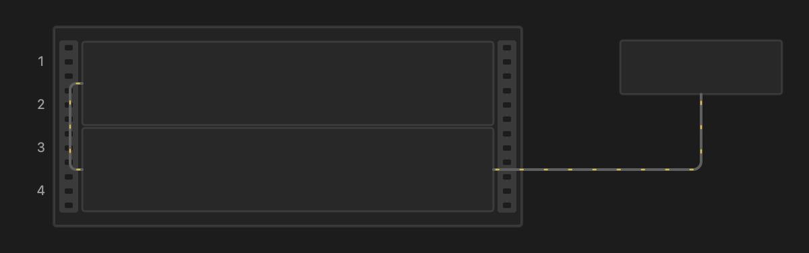

## Switches

`vlan_toggle`, `power_toggle`, `animation_toggle` and `debug_toggle` add switches on a small panel in the top-right corner. When the card is narrower than 520 px (e.g. on a phone), the panel folds into a ⚙ button:

| Switch | Off |
| --- | --- |
| **VLANs** | Datalines become static and dimmed; VLAN LEDs stop flickering |
| **Power** | Powerlines become static and dimmed |
| **Animations** | Everything stops moving – cables, LEDs, disks and fans – while keeping its colours; chip rings stay lit. Nothing is animated, so the card uses no CPU |
| **Debug** | The [debug](#debug) overlay is hidden (on: shown) |

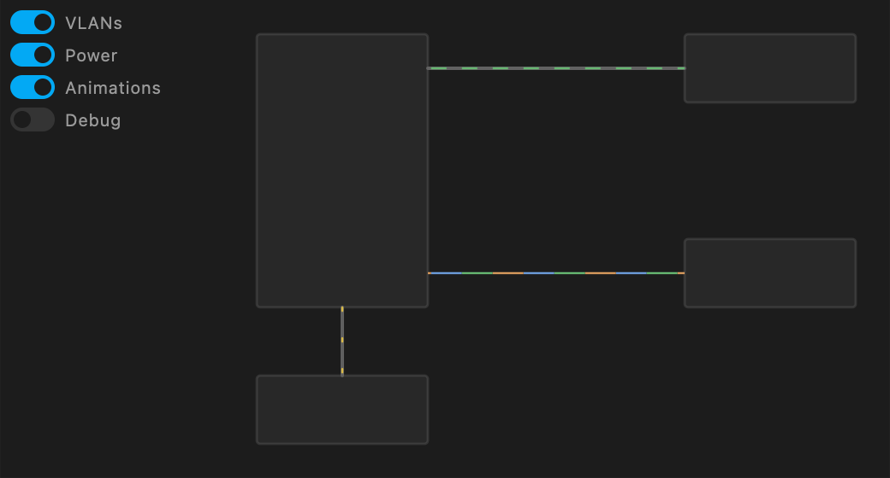

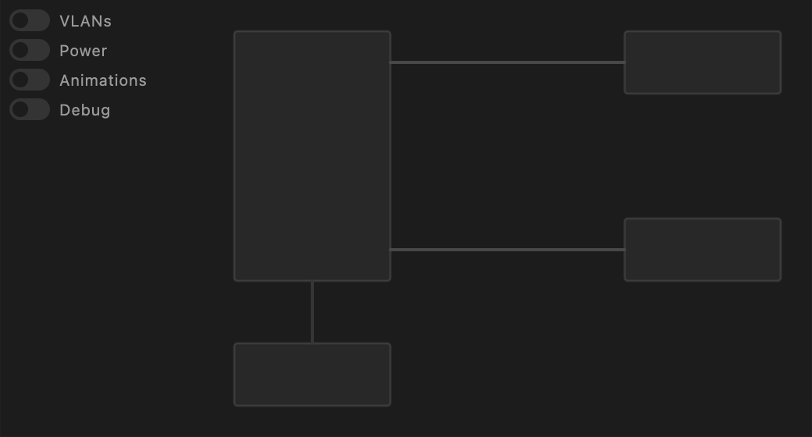

To put the panel somewhere else, give its top-left corner on the map with `toggles_at`:

```yaml
toggles_at: [860, 20]
```

The panel follows that point when you zoom or pan, but keeps its size, and it never leaves the card: a point outside the visible area moves it to the nearest edge. On a narrow card the ⚙ button sits at the same point and the panel opens from there.

Each browser remembers its own switch positions. VLANs, Power and Animations start on; Debug starts off (or on, with `debug: true`). The card also stops animating when it is scrolled out of view, when the browser tab is hidden, and when the system asks for reduced motion.

## Pan and zoom

The map can be zoomed and moved, which helps on a phone:

- **zoom**: pinch, ctrl / ⌘ + mouse wheel, a trackpad pinch, or a double-tap / double-click (×2.5; a double-tap at the maximum zoom returns to the whole map);
- **move**: drag with one finger or the mouse while zoomed in;
- **reset**: the ⤢ button in the bottom-right corner, shown while zoomed in.

Zooming stops at 4 screen px per map px. Everything is vector graphics, so text and lines stay sharp at any zoom. The zoom is not remembered after a reload. Taps and clicks on badges, chips and devices work as usual; a click at the end of a drag is ignored.

## Font

`font` sets the font family for all text on the card: labels, badges, rates, switches and the debug tooltip. If the browser can't get the font, the theme font is used.

```yaml
font: JetBrains Mono
```

[JetBrains Mono](https://www.jetbrains.com/lp/mono/) is bundled with the card (SIL Open Font License) and loaded from the card's own folder – nothing is fetched from the internet. Any other name works if that font is installed on the viewing device. A monospace font also makes badge widths exact, which helps when aligning rows.

## `look`

`look: depth` gives the map a subtle 3D feel: soft shadows under racks, devices, badges and chips, a slight lift on frames, metallic rack rails and darker rack holes. Lines and animations are unchanged. The default `flat` draws everything without shadows.

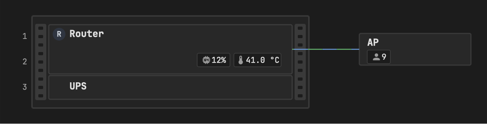

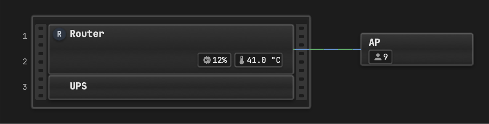

## `background`

A decorative backdrop behind the whole map, drawn once (it costs nothing while animating):

| Value | Background |
| --- | --- |
| `none` (default) | The card's own background |
| `blueprint` | A technical grid – fine lines every 10 px, stronger every 50 px – with a faint blue glow |
| `pegboard` | Small dots every 12 px |
| `vignette` | A soft light in the middle, darker towards the edges |
| a colour, e.g. `"#1a2230"` | A plain colour |
| an image URL, e.g. `/local/backgrounds/desk.jpg` | Your own image, covering the map (cropped, not stretched) |

The built-in backgrounds are mixed from the card's background colour in your Home Assistant theme, so they follow light and dark themes.

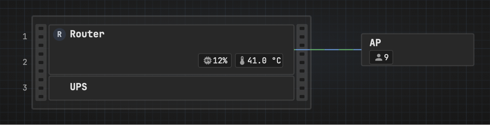

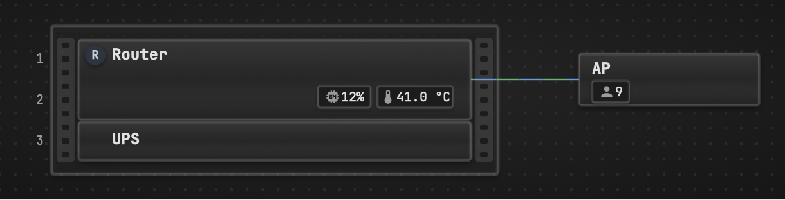

## `debug`

`debug: true`, or the **Debug** switch, helps you place things:

- a grid: thin lines every 10 px, stronger every 50 px, at map coordinates;
- a dashed outline around every device, pool, disk and fan, a circle around every chip, and a dot at each badge's `at`;
- in the browser, hovering shows the cursor position on the map and **inside** the device under it, and on a second line the id of the item under the cursor:

  ```text
  412, 260 · router: 361, 63
  router_cpu
  ```

## Errors

A mistake in the configuration shows an error that names the exact place, for example:

```text
ha-homelab-map: items[1].type: 'rackdevice' must be inside a rack's items
ha-homelab-map: items[0].items[0].u: U11–U13 does not fit in the 12U rack 'rack'
ha-homelab-map: items[1].name: unknown property – allowed: type, id, at, size, status_entity, status_map, items
ha-homelab-map: items[0]: an endpoint needs either an mdi 'icon' or a chip in 'items'
ha-homelab-map: items[0].items[0].icon: required – an mdi icon such as mdi:thermometer, or none
ha-homelab-map: items[0].items[0].thresholds[0]: needs either 'above' or 'below'
ha-homelab-map: items[0].items[0].toggle: 'containers' is not a group
ha-homelab-map: toggles_at: has no effect without a switch
ha-homelab-map: items[0].texture: expected one of hex, mesh, slots, grille, carbon, ribbed, brushed, glass, tpl, mtk, dll, hpe, unf
ha-homelab-map: items[0].items[0].caption: needs 'size' – captions are shown only on LEDs with an explicit size
ha-homelab-map: datalines[0].end_edge: expected one of top, right, bottom, left
ha-homelab-map: datalines[0].flow: 'dominant' needs both 'rx' and 'tx'
ha-homelab-map: datalines[0].end_device: 'c' is not a device – lines connect devices and ports only
ha-homelab-map: datalines[0].points: an open end needs at least one point – the last point is where the line fades out
```

`items[0].items[2]` is the third item inside the first item – counting starts at 0.
