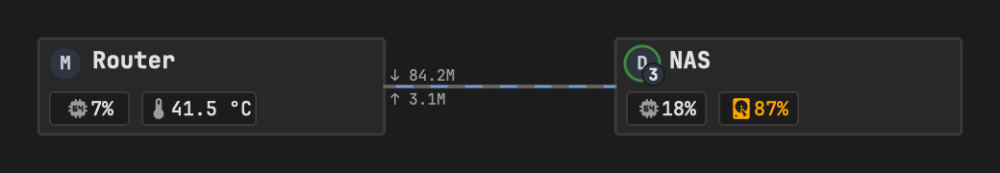
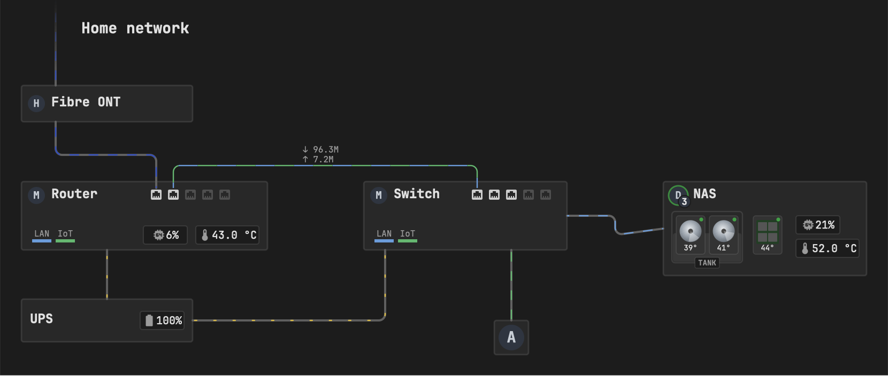
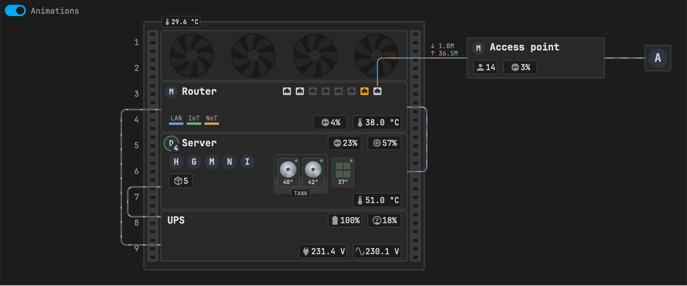

# Examples

Three complete setups, from small to large. Copy one, replace the entity ids with your own, and move things around with the **Debug** switch on. Every option is explained in [Configuration](configuration.md).

- [Starter: two devices and a cable](#starter-two-devices-and-a-cable)
- [Home network: devices on a desk](#home-network-devices-on-a-desk)
- [Rack: router, server and UPS in a 9U cabinet](#rack-router-server-and-ups-in-a-9u-cabinet)

Logos are images you put in `config/www/` – here in `config/www/ha-homelab-map/logos/`. No logos are shipped with the card, so the screenshots show a letter in their place. Good sources are [dashboard-icons](https://github.com/homarr-labs/dashboard-icons) and [Simple Icons](https://simpleicons.org).

## Starter: two devices and a cable

A router and a NAS with a few values, joined by a LAN cable whose animation follows the traffic. The NAS logo shows 3 pending OS updates, and its disk usage is past the orange threshold.

```yaml
type: custom:ha-homelab-map
font: JetBrains Mono
vlans: {LAN: "#6c9cda"}
items:
  - type: device
    id: router
    at: [0, 0]
    size: [180, 50]
    status_entity: binary_sensor.router_online
    items:
      - {type: chip, id: router_logo, at: [6, 5], image: /local/ha-homelab-map/logos/mikrotik.svg}
      - {type: label, id: router_name, at: [28, 6], text: Router, size: 12, bold: true}
      - {type: badge, id: router_cpu, at: [6, 28], entity: sensor.router_cpu, icon: "mdi:cpu-64-bit", size: 10, show_border: true, thresholds: [{above: 80, color: orange}, {above: 90, color: red}]}
      - {type: badge, id: router_temp, at: [54, 28], entity: sensor.router_temperature, icon: "mdi:thermometer", decimals: 1, size: 10, show_border: true, thresholds: [{above: 70, color: orange}, {above: 85, color: red}]}
  - type: device
    id: nas
    at: [300, 0]
    size: [180, 50]
    status_entity: binary_sensor.nas_online
    items:
      - {type: chip, id: nas_logo, at: [6, 5], image: /local/ha-homelab-map/logos/debian.svg, small_entity: sensor.nas_os_updates, update_entity: sensor.nas_os_updates}
      - {type: label, id: nas_name, at: [28, 6], text: NAS, size: 12, bold: true}
      - {type: badge, id: nas_cpu, at: [6, 28], entity: sensor.nas_cpu, icon: "mdi:cpu-64-bit", size: 10, show_border: true}
      - {type: badge, id: nas_disk, at: [54, 28], entity: sensor.nas_disk_used, icon: "mdi:harddisk", size: 10, show_border: true, thresholds: [{above: 85, color: orange}, {above: 95, color: red}]}
datalines:
  - id: router-nas
    start_device: router
    start_edge: right
    end_device: nas
    end_edge: left
    vlans: [LAN]
    flow: dominant
    rx: sensor.router_ether2_tx
    tx: sensor.router_ether2_rx
    rates_at: start
```



What to notice:

- `status_entity` on each device turns its frame red when the device is unreachable, and makes a click on it open that entity.
- `rx` / `tx` are taken from the **router's** port, so they are swapped: what the router sends (`tx`) is what the NAS receives.
- `rates_at: start` shows the current speed next to the router.

## Home network: devices on a desk

An ONT, a router, a switch, a NAS with a ZFS pool, a TV and a UPS – without a rack. Cables end on ports, the trunk carries two VLANs, and the cable at the top leaves for "the internet".

```yaml
type: custom:ha-homelab-map
font: JetBrains Mono
vlans: {WAN: "#2d4abe", LAN: "#6c9cda", IoT: "#66b771"}
items:
  - {type: label, id: title, at: [56, 40], text: Home network, size: 14, bold: true}
  - type: device
    id: ont
    at: [0, 100]
    size: [160, 34]
    items:
      - {type: chip, id: ont_logo, at: [6, 9], image: /local/ha-homelab-map/logos/huawei.svg}
      - {type: label, id: ont_name, at: [28, 10], text: Fibre ONT, size: 12, bold: true}
  - type: device
    id: router
    at: [0, 190]
    size: [230, 64]
    status_entity: binary_sensor.router_online
    items:
      - {type: chip, id: router_logo, at: [6, 5], image: /local/ha-homelab-map/logos/mikrotik.svg}
      - {type: label, id: router_name, at: [28, 6], text: Router, size: 12, bold: true}
      - type: ports
        id: router_ports
        at: [120, 6]
        items:
          - {type: port, id: r1, at: [0, 0], entity: sensor.router_sfp_rate}
          - {type: port, id: r2, at: [16, 0], entity: sensor.router_ether2_rate}
          - {type: port, id: r3, at: [32, 0], entity: sensor.router_ether3_rate}
          - {type: port, id: r4, at: [48, 0], entity: sensor.router_ether4_rate}
          - {type: port, id: r5, at: [64, 0], entity: sensor.router_ether5_rate}
      - {type: led, id: router_lan, at: [10, 54], size: [18, 3], vlan: LAN, caption: LAN}
      - {type: led, id: router_iot, at: [32, 54], size: [18, 3], vlan: IoT, caption: IoT}
      - {type: badge, id: router_cpu, at: [114, 41.5], entity: sensor.router_cpu, icon: "mdi:cpu-64-bit", size: 10, show_border: true, thresholds: [{above: 80, color: orange}, {above: 90, color: red}]}
      - {type: badge, id: router_temp, at: [163, 41.5], entity: sensor.router_temperature, icon: "mdi:thermometer", decimals: 1, size: 10, show_border: true, thresholds: [{above: 70, color: orange}, {above: 85, color: red}]}
  - type: device
    id: switch
    at: [320, 190]
    size: [190, 64]
    items:
      - {type: chip, id: switch_logo, at: [6, 5], image: /local/ha-homelab-map/logos/mikrotik.svg}
      - {type: label, id: switch_name, at: [28, 6], text: Switch, size: 12, bold: true}
      - type: ports
        id: switch_ports
        at: [100, 6]
        items:
          - {type: port, id: s1, at: [0, 0], entity: sensor.switch_ether1_rate}
          - {type: port, id: s2, at: [16, 0], entity: sensor.switch_ether2_rate}
          - {type: port, id: s3, at: [32, 0], entity: sensor.switch_ether3_rate, speed: 100Mbps}
          - {type: port, id: s4, at: [48, 0], entity: sensor.switch_ether4_rate}
          - {type: port, id: s5, at: [64, 0], entity: sensor.switch_ether5_rate}
      - {type: led, id: switch_lan, at: [10, 54], size: [18, 3], vlan: LAN, caption: LAN}
      - {type: led, id: switch_iot, at: [32, 54], size: [18, 3], vlan: IoT, caption: IoT}
  - type: device
    id: nas
    at: [600, 190]
    size: [190, 88]
    status_entity: binary_sensor.nas_online
    items:
      - {type: chip, id: nas_logo, at: [6, 5], image: /local/ha-homelab-map/logos/debian.svg, small_entity: sensor.nas_os_updates, update_entity: sensor.nas_os_updates}
      - {type: label, id: nas_name, at: [28, 6], text: NAS, size: 12, bold: true}
      - type: pool
        id: tank
        at: [8, 28]
        size: [66, 48]
        label: TANK
        usage_entity: sensor.tank_used
        status_entity: sensor.tank_state
        status_map: {ONLINE: ok, DEGRADED: warn, FAULTED: down}
        thresholds: [{above: 85, color: orange}, {above: 95, color: red}]
        items:
          - {type: hdd, id: tank_1, at: [4, 4], temperature: sensor.sda_temperature, status_entity: binary_sensor.sda_health, thresholds: [{above: 50, color: orange}, {above: 60, color: red}]}
          - {type: hdd, id: tank_2, at: [35, 4], temperature: sensor.sdb_temperature, status_entity: binary_sensor.sdb_health, thresholds: [{above: 50, color: orange}, {above: 60, color: red}]}
      - {type: ssd, id: nas_system, at: [84, 32], temperature: sensor.nvme_temperature, status_entity: binary_sensor.nvme_health}
      - {type: badge, id: nas_cpu, at: [124, 32], entity: sensor.nas_cpu, icon: "mdi:cpu-64-bit", size: 10, show_border: true, thresholds: [{above: 80, color: orange}, {above: 90, color: red}]}
      - {type: badge, id: nas_temp, at: [124, 54], entity: sensor.nas_cpu_temperature, icon: "mdi:thermometer", decimals: 1, size: 10, show_border: true, thresholds: [{above: 70, color: orange}, {above: 85, color: red}]}
  - type: endpoint
    id: tv
    at: [442, 320]
    items:
      - {type: chip, id: tv_logo, at: [4, 4], size: 24, image: /local/ha-homelab-map/logos/android.svg, status_entity: binary_sensor.tv_online}
  - type: device
    id: ups
    at: [0, 300]
    size: [160, 40]
    status_entity: sensor.ups_status
    status_map: {LB: down, OB: warn, OL: ok}
    items:
      - {type: label, id: ups_name, at: [8, 13], text: UPS, size: 12, bold: true}
      - {type: badge, id: ups_battery, at: [111, 11.5], entity: sensor.ups_battery, icon: "mdi:battery", size: 10, show_border: true, thresholds: [{below: 50, color: orange}, {below: 20, color: red}]}
datalines:
  - {id: internet, start_device: ont, start_edge: top, start_point: 20, points: [[32, -200]], vlans: [WAN], flow: dominant, rx: sensor.router_sfp_rx, tx: sensor.router_sfp_tx}
  - {id: ont-router, start_device: ont, start_edge: bottom, start_point: 20, end_port: r1, end_edge: top, points: [[32, 165], [126, 165]], vlans: [WAN], flow: dominant, rx: sensor.router_sfp_rx, tx: sensor.router_sfp_tx}
  - id: router-switch
    start_port: r2
    start_edge: top
    end_port: s1
    end_edge: top
    points: [[142, 175], [426, 175]]
    vlans: [LAN, IoT]
    flow: dominant
    rx: sensor.router_ether2_tx
    tx: sensor.router_ether2_rx
    rates_at: 50
    rates_placement: above
  - {id: switch-nas, start_device: switch, start_edge: right, end_device: nas, end_edge: left, points: [[555, 222], [555, 240]], vlans: [LAN], flow: dominant, rx: sensor.switch_ether2_tx, tx: sensor.switch_ether2_rx}
  - {id: switch-tv, start_device: switch, start_edge: bottom, start_point: 72.6, end_device: tv, end_edge: top, vlans: [IoT], flow: forward, status: binary_sensor.tv_online}
powerlines:
  - {id: ups-router, start_device: ups, start_edge: top, end_device: router, end_edge: bottom, end_point: 34.8, flow: forward}
  - {id: ups-switch, start_device: ups, start_edge: right, end_device: switch, end_edge: bottom, end_point: 10.5, points: [[340, 320]], flow: forward}
```



What to notice:

- **Ports**: `ont-router` and `router-switch` end on ports (`end_port: r1`, `start_port: r2`, `end_port: s1`), so those ports are expected to have a link and would turn red without one. `s3` expects 100 Mbps (`speed: 100Mbps`), so a 100 Mbps link is white, not orange.
- **The internet cable** (`internet`) has no end device: its far point `[32, -200]` lies above the map, so it runs to the top edge and fades out.
- **The UPS** uses a `status_map`: on battery (`OB`) its frame turns orange, low battery (`LB`) red.
- **Power** comes from the UPS to the router and the switch as gold dots.

## Rack: router, server and UPS in a 9U cabinet

A 9U rack with a fan panel, a router with eight ports and a VLAN legend, a server with containers and a ZFS mirror, and a UPS feeding both. An access point and a TV are outside the rack.

```yaml
type: custom:ha-homelab-map
font: JetBrains Mono
vlans: {LAN: "#6c9cda", IoT: "#66b771", NoT: "#d6995c"}
animation_toggle: true
items:
  - type: rack
    id: rack
    at: [40, 20]
    units: 9
    items:
      - {type: badge, id: rack_temp, at: [22, -7], entity: sensor.rack_temperature, icon: "mdi:thermometer", decimals: 1, size: 8, show_border: true, thresholds: [{above: 35, color: orange}, {above: 45, color: red}]}
      - {type: fanpanel, id: rack_fans, u: 1, units: 2, count: 4, entity: sensor.rack_temperature, range: [27, 35]}
      - type: rackdevice
        id: router
        u: 3
        units: 2
        status_entity: binary_sensor.router_online
        items:
          - {type: chip, id: router_logo, at: [5, 4], image: /local/ha-homelab-map/logos/mikrotik.svg}
          - {type: label, id: router_name, at: [26, 6], text: Router, size: 12, bold: true}
          - type: ports
            id: router_ports
            at: [150, 5]
            items:
              - {type: port, id: e1, at: [0, 0], entity: sensor.router_ether1_rate}
              - {type: port, id: e2, at: [16, 0], entity: sensor.router_ether2_rate}
              - {type: port, id: e3, at: [32, 0], entity: sensor.router_ether3_rate}
              - {type: port, id: e4, at: [48, 0], entity: sensor.router_ether4_rate}
              - {type: port, id: e5, at: [64, 0], entity: sensor.router_ether5_rate}
              - {type: port, id: e6, at: [80, 0], entity: sensor.router_ether6_rate}
              - {type: port, id: e7, at: [96, 0], entity: sensor.router_ether7_rate}
              - {type: port, id: e8, at: [112, 0], entity: sensor.router_ether8_rate}
          - {type: led, id: router_lan, at: [10, 50], size: [18, 3], vlan: LAN, caption: LAN}
          - {type: led, id: router_iot, at: [32, 50], size: [18, 3], vlan: IoT, caption: IoT}
          - {type: led, id: router_not, at: [54, 50], size: [18, 3], vlan: NoT, caption: NoT}
          - {type: badge, id: router_cpu, at: [189, 41.5], entity: sensor.router_cpu, icon: "mdi:cpu-64-bit", size: 10, show_border: true, thresholds: [{above: 80, color: orange}, {above: 90, color: red}]}
          - {type: badge, id: router_temp, at: [238, 41.5], entity: sensor.router_temperature, icon: "mdi:thermometer", decimals: 1, size: 10, show_border: true, thresholds: [{above: 70, color: orange}, {above: 85, color: red}]}
      - type: rackdevice
        id: server
        u: 5
        units: 3
        status_entity: binary_sensor.server_online
        items:
          - {type: chip, id: server_logo, at: [5, 4], image: /local/ha-homelab-map/logos/debian.svg, small_entity: sensor.server_os_updates, update_entity: sensor.server_os_updates}
          - {type: label, id: server_name, at: [26, 6], text: Server, size: 12, bold: true}
          - {type: badge, id: server_cpu, at: [207, 3], entity: sensor.server_cpu, icon: "mdi:cpu-64-bit", size: 10, show_border: true, thresholds: [{above: 80, color: orange}, {above: 90, color: red}]}
          - {type: badge, id: server_ram, at: [256, 3], entity: sensor.server_ram, icon: "mdi:memory", size: 10, show_border: true, thresholds: [{above: 80, color: orange}, {above: 90, color: red}]}
          - type: group
            id: containers
            at: [10, 26]
            items:
              - {type: chip, id: c_ha, at: [0, 0], size: 18, image: /local/ha-homelab-map/logos/home-assistant.svg, status_entity: sensor.ha_state}
              - {type: chip, id: c_grafana, at: [22, 0], size: 18, image: /local/ha-homelab-map/logos/grafana.svg, status_entity: sensor.grafana_state, update_entity: binary_sensor.grafana_update}
              - {type: chip, id: c_mqtt, at: [44, 0], size: 18, image: /local/ha-homelab-map/logos/mosquitto.svg, status_entity: sensor.mqtt_state}
              - {type: chip, id: c_nodered, at: [66, 0], size: 18, image: /local/ha-homelab-map/logos/node-red.svg, status_entity: sensor.nodered_state}
              - {type: chip, id: c_influx, at: [88, 0], size: 18, image: /local/ha-homelab-map/logos/influxdb.svg, status_entity: sensor.influxdb_state}
          - {type: badge, id: server_containers, at: [10, 50], entity: sensor.server_containers, icon: "mdi:docker", size: 10, show_border: true, toggle: containers}
          - type: pool
            id: tank
            at: [140, 26]
            size: [66, 48]
            label: TANK
            usage_entity: sensor.tank_used
            status_entity: sensor.tank_state
            status_map: {ONLINE: ok, DEGRADED: warn, FAULTED: down}
            thresholds: [{above: 85, color: orange}, {above: 95, color: red}]
            items:
              - {type: hdd, id: tank_1, at: [4, 4], temperature: sensor.sdb_temperature, status_entity: binary_sensor.sdb_health, thresholds: [{above: 50, color: orange}, {above: 60, color: red}]}
              - {type: hdd, id: tank_2, at: [35, 4], temperature: sensor.sdc_temperature, status_entity: binary_sensor.sdc_health, thresholds: [{above: 50, color: orange}, {above: 60, color: red}]}
          - {type: ssd, id: server_system, at: [212, 30], temperature: sensor.sda_temperature, status_entity: binary_sensor.sda_health}
          - {type: badge, id: server_temp, at: [238, 74], entity: sensor.server_cpu_temperature, icon: "mdi:thermometer", decimals: 1, size: 10, show_border: true, thresholds: [{above: 70, color: orange}, {above: 85, color: red}]}
      - type: rackdevice
        id: ups
        u: 8
        units: 2
        status_entity: sensor.ups_status
        status_map: {LB: down, OB: warn, OL: ok}
        items:
          - {type: label, id: ups_name, at: [8, 6], text: UPS, size: 12, bold: true}
          - {type: badge, id: ups_battery, at: [207, 3], entity: sensor.ups_battery, icon: "mdi:battery", size: 10, show_border: true, thresholds: [{below: 50, color: orange}, {below: 20, color: red}]}
          - {type: badge, id: ups_load, at: [256, 3], entity: sensor.ups_load, icon: "mdi:gauge", size: 10, show_border: true, thresholds: [{above: 70, color: orange}, {above: 90, color: red}]}
          - {type: badge, id: ups_input, at: [171, 41.5], entity: sensor.ups_input_voltage, icon: "mdi:power-plug", decimals: 1, size: 10, show_border: true}
          - {type: badge, id: ups_output, at: [238, 41.5], entity: sensor.ups_output_voltage, icon: "mdi:sine-wave", decimals: 1, size: 10, show_border: true}
  - type: device
    id: ap
    at: [440, 40]
    size: [170, 50]
    status_entity: binary_sensor.ap_online
    items:
      - {type: chip, id: ap_logo, at: [6, 5], image: /local/ha-homelab-map/logos/mikrotik.svg}
      - {type: label, id: ap_name, at: [28, 6], text: Access point, size: 12, bold: true}
      - {type: badge, id: ap_clients, at: [8, 28], entity: sensor.ap_clients, icon: "mdi:account", units: none, size: 10, show_border: true}
      - {type: badge, id: ap_cpu, at: [45, 28], entity: sensor.ap_cpu, icon: "mdi:cpu-64-bit", size: 10, show_border: true}
  - type: endpoint
    id: tv
    at: [660, 49]
    items:
      - {type: chip, id: tv_logo, at: [4, 4], size: 24, image: /local/ha-homelab-map/logos/android.svg, status_entity: binary_sensor.tv_online}
datalines:
  - id: router-ap
    start_port: e8
    start_edge: top
    end_device: ap
    end_edge: left
    points: [[329, 65]]
    vlans: [LAN, IoT, NoT]
    flow: dominant
    rx: sensor.router_ether8_rx
    tx: sensor.router_ether8_tx
    rates_at: end
    rates_placement: above
  - {id: ap-tv, start_device: ap, start_edge: right, end_device: tv, end_edge: left, vlans: [IoT], flow: forward, status: binary_sensor.tv_online}
  - {id: server-router, start_device: server, start_edge: right, end_device: router, end_edge: right, points: [[390, 206], [390, 126]], vlans: [LAN], flow: dominant, rx: sensor.router_ether2_tx, tx: sensor.router_ether2_rx}
powerlines:
  - {id: ups-server, start_device: ups, start_edge: left, start_point: 11.3, end_device: server, end_edge: left, end_point: 70.2, points: [[20, 262], [20, 225]], flow: forward}
  - {id: ups-router, start_device: ups, start_edge: left, start_point: 67.7, end_device: router, end_edge: left, end_point: 54.8, points: [[12, 297], [12, 129]], flow: forward}
```



What to notice:

- **Rackdevices** are placed with `u` / `units` only; their content is relative to their top-left corner.
- **The fan panel** at U1–2 spins faster as the rack temperature rises from 27 to 35 °C, and sits behind the cables.
- **The container chips** are in a `group`, and the Docker count badge has `toggle: containers` – clicking it hides or shows them.
- **Frames on badges** (`show_border: true`) and the right-aligned rows come from the same spacing rule: each row ends 8 px inside the device, 8 px between frames. With `font: JetBrains Mono` every character is 0.6 × the font size wide, so widths are easy to compute.
- **The power cables** enter the rack between the unit numbers and are nested, so they never cross.
